<div align="center">

# ReachPrioritizer

### Find the vulnerabilities attackers can actually reach.

Reachability-aware, taint-aware and AI-assisted vulnerability prioritization for **JavaScript · TypeScript · Node.js**


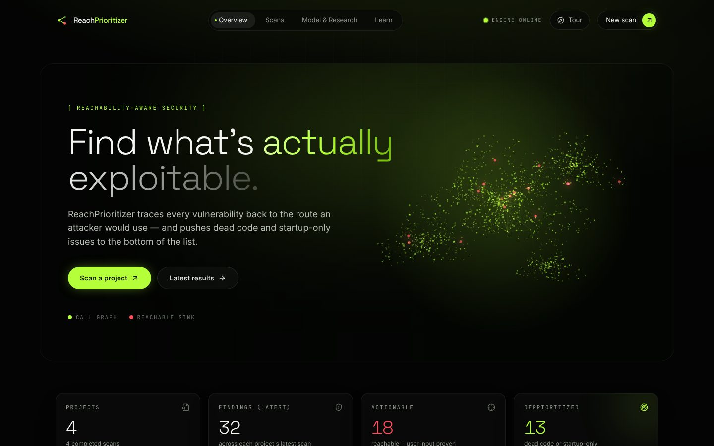

</div>

---

## Table of contents
1. [Why ReachPrioritizer?](#why-reachprioritizer)
2. [Features](#features)
3. [Results](#results)
4. [Quick start](#quick-start)
5. [Using it](#using-it)
6. [How it works](#how-it-works)
7. [Screenshots](#screenshots)
8. [Project structure](#project-structure)
9. [Tech stack](#tech-stack)
10. [Testing & evaluation](#testing--evaluation)
11. [Documentation](#documentation)
12. [Limitations & roadmap](#limitations--roadmap)
13. [Acknowledgements & license](#acknowledgements--license)

---

## Why ReachPrioritizer?

Security scanners and AI vulnerability detectors judge code **in isolation**. They report every suspicious function, including code that **never runs**, code that **only runs while the server starts**, and code that **never receives user data**. Teams drown in alerts and the dangerous ones get lost.

ReachPrioritizer answers a sharper question: **which vulnerabilities can an attacker actually reach, with data they control?**

| A typical scanner says | ReachPrioritizer says |
|---|---|
| "SQL injection in `UserService.search`." | "SQL injection in `UserService.search`. **Reachable** via `POST /api/users/search`. User input (`req.body.term`) flows `searchUsers → UserService.search → db.query`. **Risk 73/100 (Critical).**" |
| Every finding looks equally urgent | Findings are ranked by an explainable 0–100 risk score |
| Dead code raises alarms | Dead and startup-only code is detected and ranked low |

Source code is only **parsed, never executed**.

---

## Features

**Analysis engine** (Node.js + Babel)
- Cross-file **call graph**: CommonJS and ES modules, re-exports, classes and ES5 constructor functions, `this.method()`, object literals, Express/Koa routers, callbacks, IIFEs, TypeScript.
- **Entry-point detection** at two levels: startup roots (`listen`, `createServer`, `package.json` main/bin/start) and request roots (Express / Fastify / Koa / hapi routes, server handlers, serverless handlers, Next.js API routes). A route only counts if the code that registers it actually runs.
- **Reachability** for every function (`reachable`, `startup_only`, `unreachable`) with the shortest **attack path**.
- **Interprocedural taint tracking** from user-input sources to sinks, aware of sanitizers and guard clauses, across functions and files.
- **20+ rules / 15 CWE classes:** command injection, code injection (`eval`, `vm`, `mathjs`), SQL and NoSQL injection, path traversal, SSRF, open redirect, reflected / DOM XSS, prototype pollution, XXE, insecure deserialization, ReDoS, hardcoded secrets, weak crypto, disabled TLS verification.

**Attack simulator, dependency check, GitHub and compare** (new in v2.1)
- **Attack simulator:** for every finding where user input reaches the bug, the exact attacker request (curl / fetch / raw HTTP, with the full URL including router mount prefixes and the real input field) plus a step-by-step replay that ends with what the server would execute, e.g. `SELECT … LIKE '%' OR '1'='1' -- %'`. Simulation only: nothing is sent.
- **Reachable dependency check:** `package.json` / lockfile versions are looked up in the **OSV** database (CVE / GHSA advisories), then the call graph decides whether the vulnerable package is actually called from a reachable route, with user input, and whether the advisory's function (e.g. `lodash.template`) is the one being called.
- **Scan from a GitHub link:** paste `https://github.com/owner/repo` (optional branch / tag); the archive is downloaded with the same safety checks as an upload, and the commit SHA is recorded.
- **Compare scans:** upload a new version (or pull the latest commit) and see **fixed / new / still-open** findings, both **call graphs side by side** with the attack path of any finding lit up in both versions, route and reachability changes, and a trend chart.

**AI**
- Function-level classifier trained on **21,896** real JavaScript functions (JsVul, repository-disjoint splits).
- TF-IDF + Logistic Regression shipped; **CodeBERT** GPU training script included. The best model is picked automatically by its **measured** test F1.

**Prioritization**
- `risk = 100 × reachability × (0.45·severity + 0.35·exploitability + 0.20·AI)`, with a full breakdown for every finding.

**Web app**
- Upload a ZIP or paste a GitHub link, follow live progress, browse ranked findings with filters, and open any finding for its **attack simulation**, **attack path**, **data flow**, highlighted code, score breakdown and fix advice.
- Interactive **call graph** with path highlighting.
- **Compare** page with side-by-side call graphs and a trend chart.
- **Guided tour** (30 steps across every page), a **Learn** knowledge base with an interactive risk calculator, and "?" explainers on every panel.
- Exports: **JSON, SARIF 2.1.0** (GitHub code scanning / VS Code) and **CSV**.

**Engineering**
- Safe ZIP handling (path traversal, symlinks, zip bombs, size limits), background scans with progress, SQLite schema with per-scan graphs, environment-based configuration, and 47 automated tests.

---

## Results

All numbers are produced by `python evaluation/scripts/run_experiments.py`. See [docs/EVALUATION.md](docs/EVALUATION.md).

**Detection**: 4 fully labeled applications, 43 functions:

| Detector | Precision | Recall | F1 |
|---|---:|---:|---:|
| **ReachPrioritizer taint engine** | **1.00** | **1.00** | **1.00** |
| v1 prototype regex rules | 0.89 | 0.36 | 0.52 |
| AI classifier alone | 0.53 | 0.36 | 0.43 |
| ESLint + eslint-plugin-security | 0.63 | 0.23 | 0.33 |

**Real-world apps** ([OWASP NodeGoat](https://github.com/OWASP/NodeGoat), [DVNA](https://github.com/appsecco/dvna); pinned commits): **11/11** documented code-level vulnerabilities found and marked reachable. ESLint plugin-security finds 2/11.

**Reachability**: **54/54** labeled functions classified correctly.

**Prioritization**: mean over apps with exploitable bugs (relevant = vulnerable **and** reachable):

| Ranking scheme | P@1 | NDCG@5 | MAP |
|---|---:|---:|---:|
| Severity only (classic SAST) | 0.60 | 0.82 | 0.81 |
| AI only | 0.20 | 0.17 | 0.32 |
| AI + severity | 0.80 | 0.76 | 0.75 |
| AI + reachability | 0.20 | 0.44 | 0.50 |
| AI + severity + reachability (v1) | 1.00 | 0.95 | 0.97 |
| **Full ReachPrioritizer** | **1.00** | **1.00** | **1.00** |

> The controlled apps are small and partly written by the team. The real-world ground truth covers documented vulnerabilities only, so it measures recall, not precision. See the threats to validity in [docs/EVALUATION.md](docs/EVALUATION.md).

---

## Quick start

**Requirements:** Node.js 18+, Python 3.10–3.12, Git.

### Windows: two double-clicks

| Step | File | What it does |
|---|---|---|
| 1 (once) | **`setup.bat`** | Checks Node.js and Python, creates `.venv`, installs the Python and npm packages, and runs a self-check |
| 2 (every time) | **`start.bat`** | Starts the API and the website in two windows, waits until both are ready, then opens **http://localhost:5173** |
| – | `stop.bat` | Stops both servers |

### Manual setup (any OS)

```bash
git clone https://github.com/HardikChawhan/ReachPrioritizer.git
cd ReachPrioritizer

npm install                                   # analysis engine
python -m venv .venv
# Windows: .venv\Scripts\activate     Linux/macOS: source .venv/bin/activate
pip install -r backend/requirements.txt       # API + AI
cd frontend && npm install && cd ..           # web app
```

Start it (two terminals):

```bash
cd backend && uvicorn app.main:app --reload --port 8000     # API  -> http://127.0.0.1:8000/docs
cd frontend && npm run dev                                  # UI   -> http://localhost:5173
```

Open **http://localhost:5173** and accept the guided tour. Then click **New scan** and drop `test-applications/express-app.zip`.

---

## Using it

### In the browser
1. **New scan**: upload a `.zip` of a JS/TS/Node project (≤ 100 MB; `node_modules`, tests and build files are ignored) **or paste a public GitHub link**.
2. **Scan results**: read the list top-down. "Actionable" findings are reachable and have proven user input. Use the filters for risk, reachability, data flow and type (code / dependency / AI).
3. **Finding detail**: the attack simulator (press **Replay attack**), attack path, data flow, code, score breakdown and how to fix it. Dependency findings show the advisories, where the package is called and the upgrade command.
4. **Call graph**: click a red node to light up the path from an entry point.
5. **New version → Compare**: after fixing, scan the new code and open **Compare with previous**. Demo: scan `test-applications/express-app.zip`, then upload `test-applications/express-app-v2.zip` as its new version.
6. **Export**: SARIF for GitHub code scanning, JSON for tooling, CSV for spreadsheets.

Lost? Click **Tour** in the header, open **Learn**, or press any **?** button.

### From the command line
```bash
node analyzer/analyze.js --project path/to/app --pretty > analysis.json
```

### Through the API
```bash
curl -F file=@test-applications/express-app.zip http://127.0.0.1:8000/api/projects/upload
curl -H "Content-Type: application/json" -d '{"url":"https://github.com/OWASP/NodeGoat"}' http://127.0.0.1:8000/api/projects/from-github
curl http://127.0.0.1:8000/api/scans/<scan_id>
curl "http://127.0.0.1:8000/api/scans/<scan_id>/findings?reachability=reachable&taint=user_input"
curl -o report.sarif "http://127.0.0.1:8000/api/scans/<scan_id>/export?format=sarif"
curl http://127.0.0.1:8000/api/scans/<old_scan_id>/compare/<new_scan_id>
```
Full reference: [docs/BACKEND_API.md](docs/BACKEND_API.md).

---

## How it works

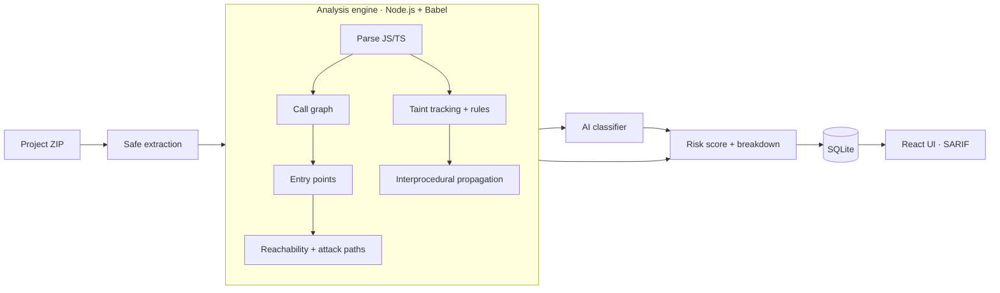

1. **Parse.** Every file becomes an AST (`@babel/parser`, with JSX and TypeScript).
2. **Call graph.** Calls, imports, classes, routers and callbacks are resolved across files.
3. **Entry points.** Startup roots and request roots (routes and handlers) are detected. Routes in dead code are marked inactive.
4. **Reachability.** BFS from the entry points gives each function `reachable`, `startup_only` or `unreachable`, plus its shortest call path.
5. **Taint.** Values from `req.body/query/params/headers/cookies…` are followed through assignments, string building and calls (with per-parameter summaries across functions). Reaching a sink without a sanitizer or guard creates a finding.
6. **AI.** Each function gets a vulnerability probability.
7. **Score.** `100 × reachability (1.0 / 0.4 / 0.2) × (0.45·severity + 0.35·exploitability + 0.20·AI)`.
8. **Attack simulation.** From the route (with mount prefixes), the input label (`query.file`, `body.term`, …) and a template of the sink value (`SELECT … '{{INPUT}}'`), the backend writes the attack request and the resulting query / command.
9. **Dependencies.** Package versions → OSV advisories → which functions call the package, and whether those are reachable.

Deep dives: [Architecture](docs/ARCHITECTURE.md) · [Analysis engine](docs/ANALYSIS_ENGINE.md) · [AI model](docs/AI_MODEL_AND_TRAINING.md).

---

## Screenshots

| Ranked findings | Finding with attack path |
|---|---|
| 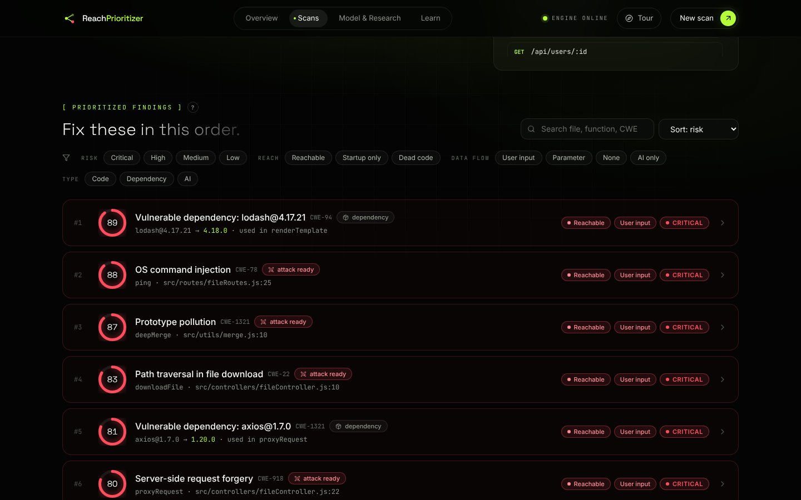 | 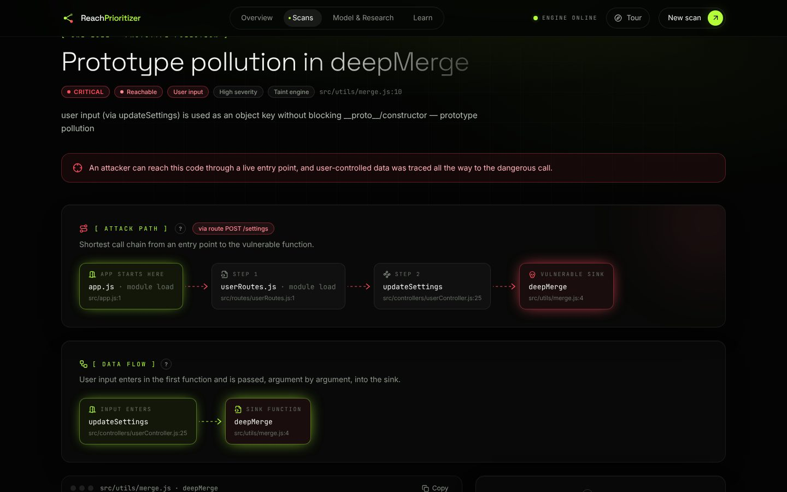 |
| **Interactive call graph** | **Guided tour** |
| 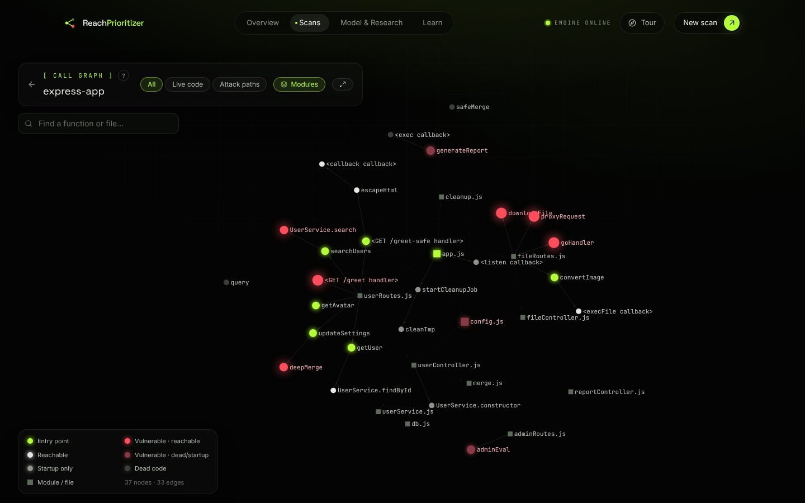 | 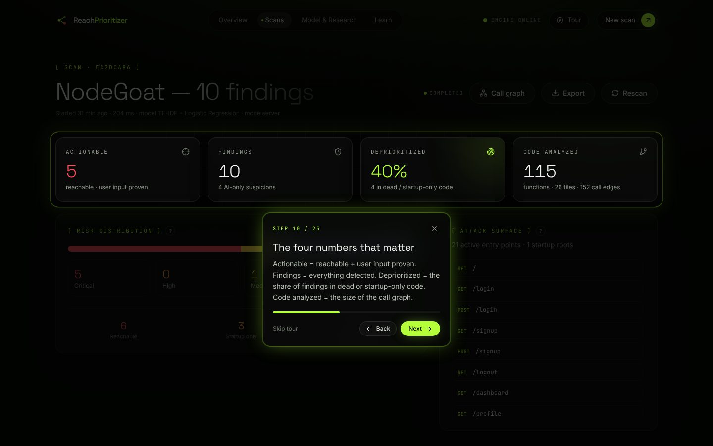 |
| **Attack simulator** | **Compare scans side by side** |
| 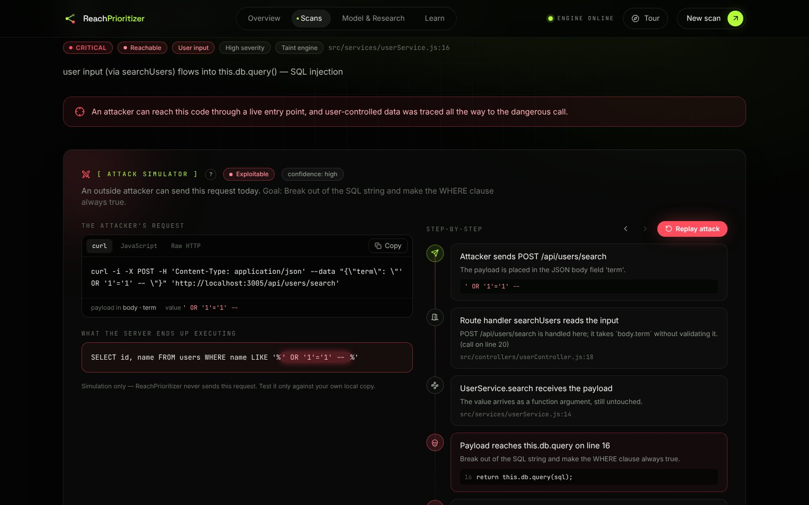 | 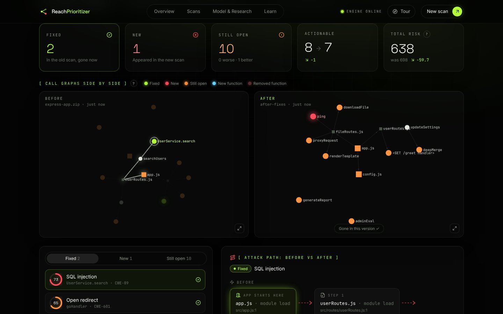 |
| **Scan from GitHub** | **Reachable dependency check** |
| 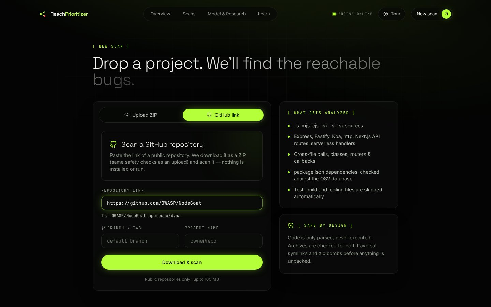 | 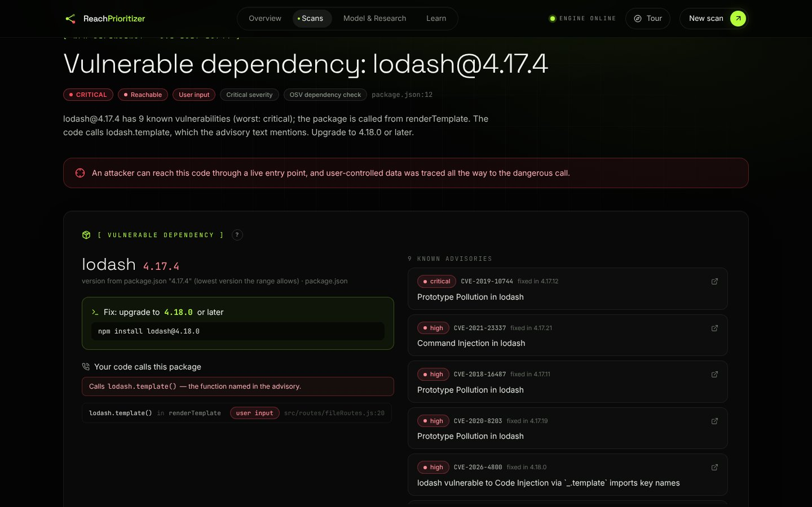 |
| **Model & research** | **Learn + risk calculator** |
| 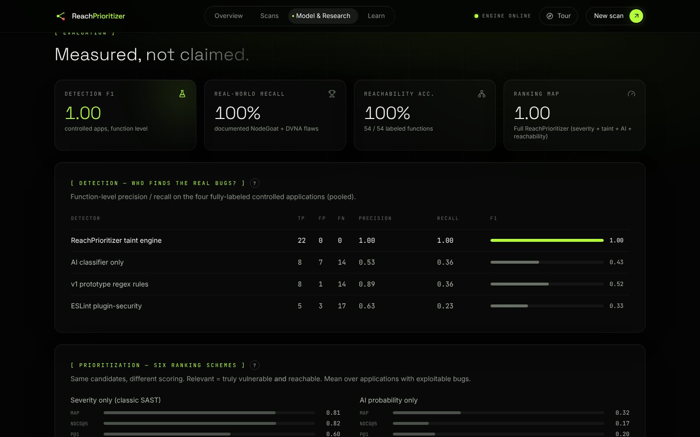 | 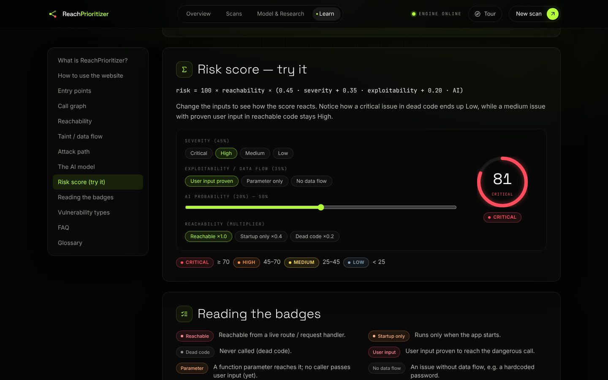 |

---

## Project structure

```
analyzer/            Static-analysis engine (call graph, entry points, reachability, taint, rules) + tests
backend/             FastAPI service: uploads, scan pipeline, scoring, persistence, exports + tests
ai/                  Classifier inference, TF-IDF & CodeBERT training, shipped TF-IDF checkpoint
frontend/            React + Vite + Tailwind web app (tour, Learn page, call graph)
test-applications/   4 labeled benchmark apps + ready-to-upload zips
evaluation/          Experiments, baselines (v1 regex, ESLint), real-world ground truth, results
preprocessing/       Phase 1: JsVul cleaning, dedup and repository-disjoint split
reports/             Phase 1 dataset statistics (JSON)
scripts/             Dataset download + rebuild
docs/                Documentation, mentor guide, research paper, screenshots
```

File-by-file: [docs/REPOSITORY_GUIDE.md](docs/REPOSITORY_GUIDE.md).

---

## Tech stack

| Layer | Technology |
|---|---|
| Analysis engine | Node.js 18+, `@babel/parser`, `minimist` |
| Backend | Python, FastAPI, Uvicorn, SQLite |
| AI | scikit-learn (TF-IDF + Logistic Regression); PyTorch + Hugging Face Transformers (CodeBERT, optional) |
| Frontend | React 18, React Router, Vite 6, Tailwind CSS 3, react-force-graph-2d, lucide-react, self-hosted variable fonts |
| Reports | SARIF 2.1.0, JSON, CSV |
| Evaluation | Python, ESLint + eslint-plugin-security, OWASP NodeGoat, DVNA |

---

## Testing & evaluation

```bash
npm run test:analyzer                          # 11 engine tests (ground truth + focused cases)
cd backend && python -m pytest                 # 36 API / pipeline / safety / scoring / feature tests
python evaluation/scripts/run_experiments.py   # regenerate evaluation/results/*

# optional extras for the evaluation
bash evaluation/realworld/fetch_realworld.sh             # NodeGoat + DVNA
cd evaluation/baselines/eslint && npm install            # ESLint baseline
```

### Dataset & model training
The JsVul dataset is larger than GitHub's file limit and is rebuilt on demand:

```bash
bash scripts/fetch_dataset.sh             # JsVul @036c7f7 -> data/processed (seed 42)
python ai/training/train_fallback.py      # TF-IDF, CPU, ~1 min
python ai/training/train_codebert.py      # CodeBERT, GPU (~45–90 min on an RTX 4060)
```

GPU setup for RTX 4060 / 5070 Ti laptops: [docs/AI_MODEL_AND_TRAINING.md](docs/AI_MODEL_AND_TRAINING.md).

---

## Documentation

| | |
|---|---|
| 🧭 [Mentor guide (plain language)](docs/MENTOR_GUIDE.md) | The project explained simply, plus a demo script |
| 🏗️ [Architecture](docs/ARCHITECTURE.md) | Components, data flow, database, design decisions |
| 🔍 [Analysis engine](docs/ANALYSIS_ENGINE.md) | Call graph, reachability, taint, every rule |
| 🔌 [Backend & API](docs/BACKEND_API.md) | Endpoints, pipeline, configuration |
| 🎨 [Frontend](docs/FRONTEND.md) | Pages, components, tour, design system |
| 🤖 [AI model & training](docs/AI_MODEL_AND_TRAINING.md) | Models, selection, GPU training |
| 📊 [Dataset](docs/DATASET.md) | JsVul pipeline and statistics |
| 📈 [Evaluation](docs/EVALUATION.md) | Methodology and results |
| 🗂️ [Repository guide](docs/REPOSITORY_GUIDE.md) | Every file explained |
| 🛠️ [Development](docs/DEVELOPMENT.md) | Setup, commands, troubleshooting, extending |
| 📄 [Research paper](docs/RESEARCH_PAPER.md) | Full technical report |

---

## Limitations & roadmap

**Limitations**
- Static analysis cannot see every dynamic JavaScript pattern (computed method names, DI containers, generated code).
- Taint tracking is flow-insensitive inside a function, and object-field aliasing is approximated.
- Out of scope: template-level XSS and authentication/authorization logic. Dependencies are checked by version (OSV) and by how the app calls them; the code inside `node_modules` is not analyzed.
- Without a lockfile, a dependency's version is the lowest one its `package.json` range allows, which can over-report.
- GitHub import works for public repositories only.
- No built-in authentication: run it locally or behind your own proxy.

**Roadmap**
- Train and benchmark CodeBERT / UniXcoder on GPU.
- Larger benchmarks (SecBench.js, CVE-linked npm packages).
- Field- and flow-sensitive taint; library summaries for ORMs and template engines.
- Live exploit verification in an isolated sandbox (Docker, no network), building on the attack simulator.
- Private GitHub repositories (token) and a GitHub Action that posts risk-ranked SARIF on every pull request.
- More languages (Python first) behind the same JSON contract.

---

## Acknowledgements & license

- [JsVul](https://github.com/jsvul/jsvul): training dataset
- [OWASP NodeGoat](https://github.com/OWASP/NodeGoat) and [DVNA](https://github.com/appsecco/dvna): real-world benchmarks (fetched, not redistributed)
- [CodeBERT](https://arxiv.org/abs/2002.08155) (Feng et al., 2020)
- [Babel](https://babeljs.io/), [FastAPI](https://fastapi.tiangolo.com/), [React](https://react.dev/), [Vite](https://vitejs.dev/), [Tailwind CSS](https://tailwindcss.com/)

Released under the **MIT License**.
