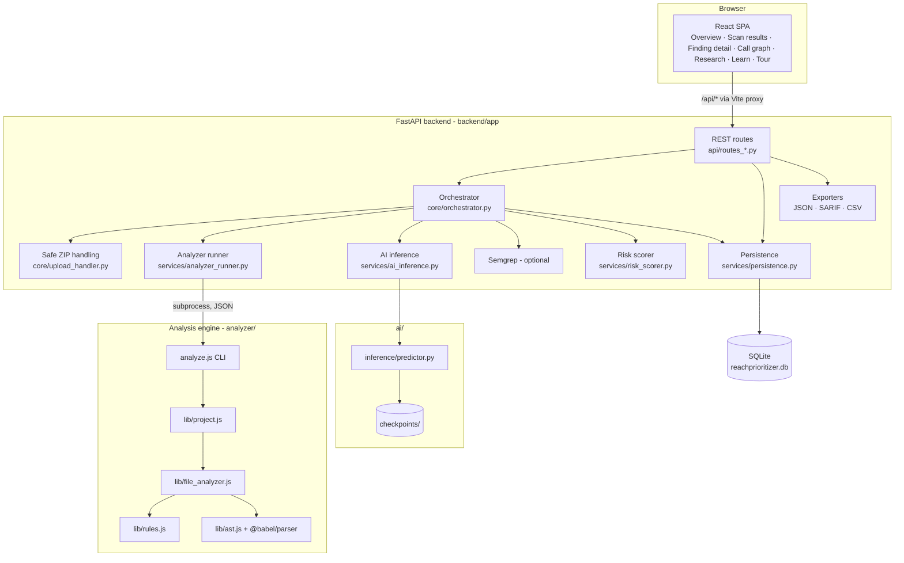
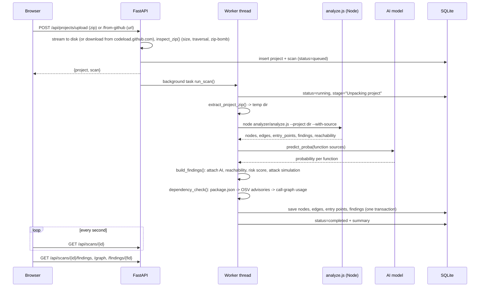
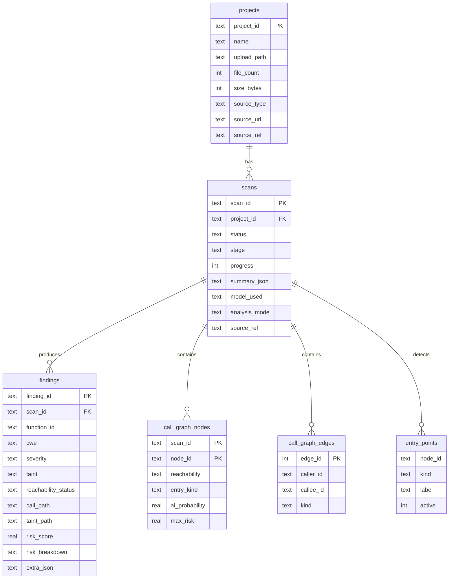

# Architecture

ReachPrioritizer is made of four cooperating parts:

| Part | Language | Folder | Responsibility |
|---|---|---|---|
| Analysis engine | Node.js | `analyzer/` | Parse code; build the call graph; detect entry points; compute reachability and call paths; taint-track user input into sinks |
| Backend API | Python / FastAPI | `backend/` | Uploads, scan orchestration, AI scoring, risk scoring, persistence, reports |
| AI | Python | `ai/` | Function-level vulnerability classifier (TF-IDF or CodeBERT) plus training scripts |
| Frontend | React / Vite | `frontend/` | Dashboard, results, attack paths, call graph, guided tour, Learn pages |

## System diagram

## Scan lifecycle

## Design decisions

| Decision | Why |
|---|---|
| **One parser (Babel) for everything** | v1 used tree-sitter in Python for functions and Babel in Node for the call graph, and joined the two by name. They named functions differently, so results were sometimes attributed to the wrong function. Now one engine emits functions, edges, reachability and findings with a single ID scheme: `path/to/file.js::functionName`. |
| **Engine as a subprocess with JSON I/O** | Keeps the JS analysis in JS (best parser ecosystem) and the ML in Python. The engine is also a standalone CLI. |
| **Static only, never execute uploads** | Safety: uploaded code is untrusted. |
| **Two-level entry points (startup vs request)** | Distinguishes "runs when the server boots" from "runs when an attacker sends a request". This is what makes `startup_only` possible. |
| **Taint summaries per parameter** | Cheap interprocedural analysis: each function records which parameters reach sinks. Call sites are linked by a BFS, so no whole-program fixpoint is needed. |
| **AI as a weighted signal (20%)** | The function-level classifier has low precision (0.28 on the test split). Concrete findings come from rules with data flow. |
| **Model auto-selection by measured test F1** | Prevents shipping an untrained or smoke-test checkpoint by mistake (a v1 bug). |
| **SQLite + worker threads** | Zero-install, adequate for a research tool. Scans run in a bounded thread pool (`RP_MAX_CONCURRENT_SCANS`) so the API stays responsive. |
| **Per-scan composite keys for graph nodes** | v1 used a global primary key, so rescanning a project overwrote older scans' graphs. |

## Data model (SQLite, schema v3)

All child tables use `ON DELETE CASCADE`. JSON-valued columns (`call_path`, `taint_path`, `risk_breakdown`, `summary_json`, …) are stored as text. `findings.extra_json` holds the attack simulation and the dependency details. A v1 database is detected at start-up and recreated; a v2 database is upgraded in place by adding the new columns, so existing scans survive (`models/database.py`).

## Security of the tool itself

- Uploads are streamed with a size cap (`RP_MAX_ZIP_MB`, default 100 MB).
- `inspect_zip` rejects absolute paths, `..` components, drive letters, too many entries, archives that expand beyond `RP_MAX_UNCOMPRESSED_MB`, suspicious compression ratios, and archives without source files.
- Extraction skips symlinks, non-source files and `node_modules`, re-checks that each destination stays inside the extraction directory, and enforces per-file and total byte limits while streaming.
- The engine only parses files and never executes them. Each scan works in a temporary directory that is deleted afterwards.
- CORS is restricted to configured origins (`RP_CORS_ORIGINS`). There is **no authentication**: run it locally or behind your own auth proxy.

## Related documents

- [ANALYSIS_ENGINE.md](ANALYSIS_ENGINE.md) — algorithms in detail
- [BACKEND_API.md](BACKEND_API.md) — every endpoint and module
- [FRONTEND.md](FRONTEND.md) — pages, components, tour
- [AI_MODEL_AND_TRAINING.md](AI_MODEL_AND_TRAINING.md)
