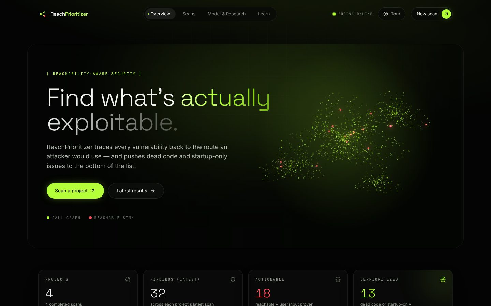
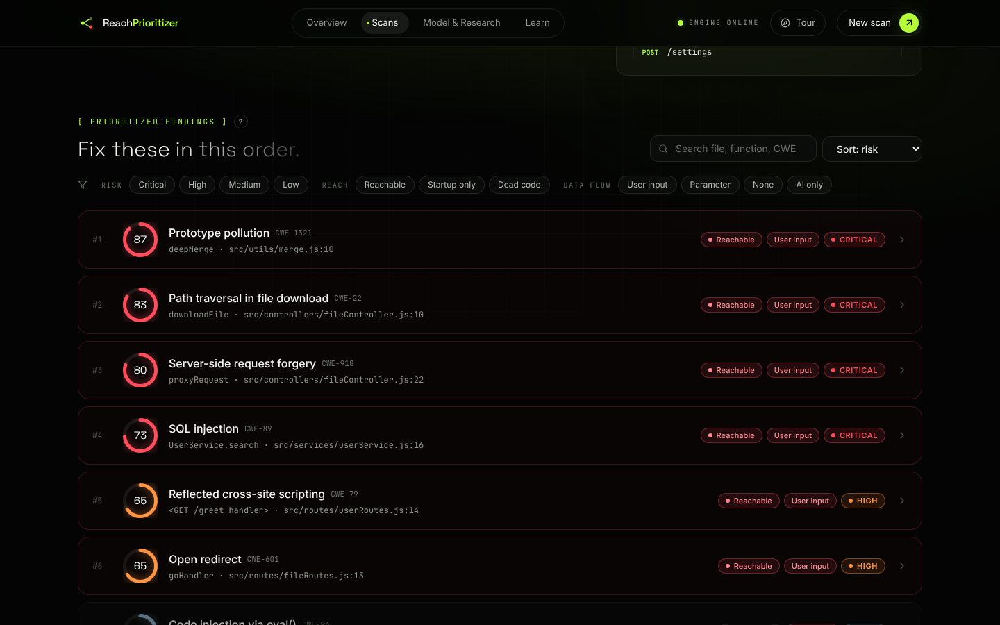
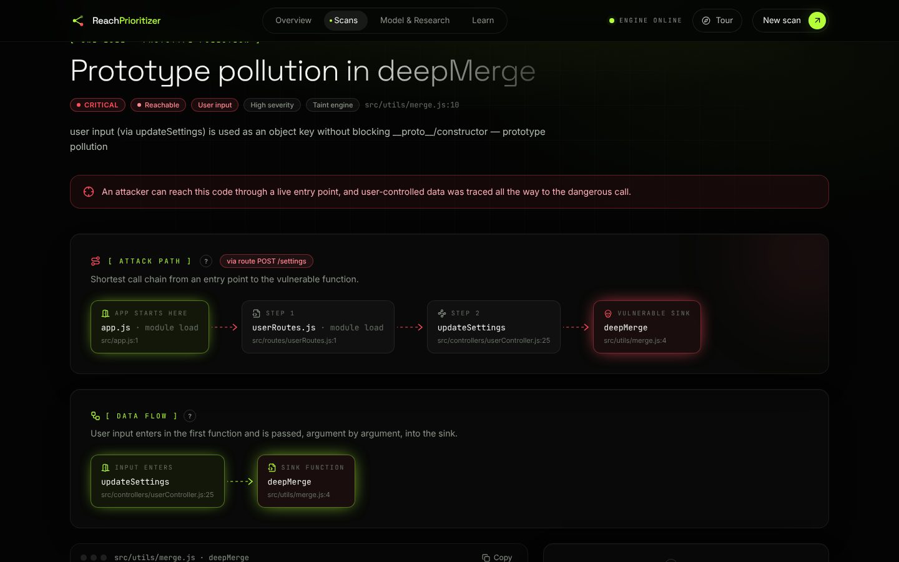
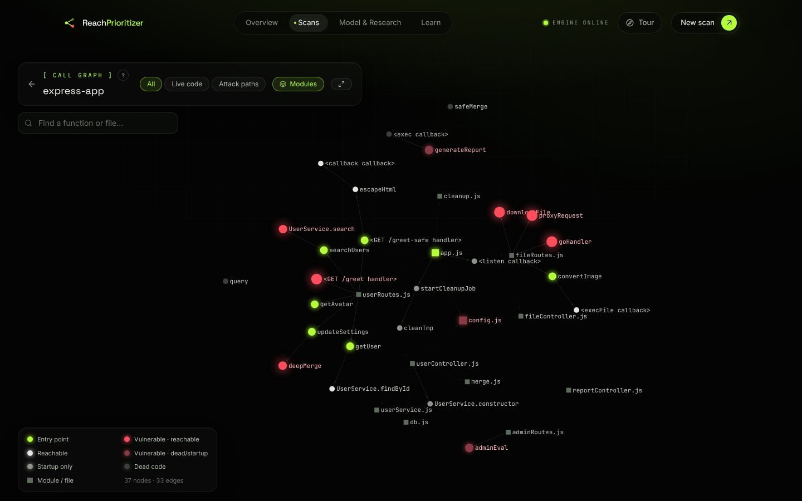
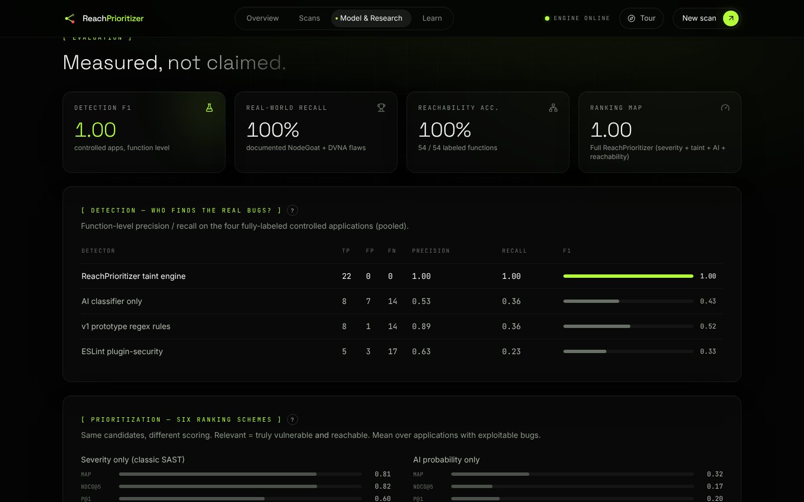
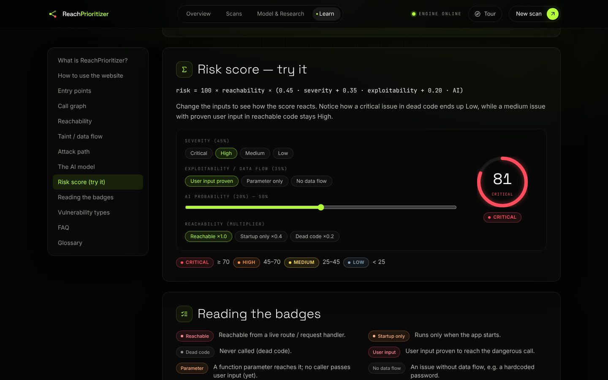

# Frontend (`frontend/`)

React 18 single-page app, built with Vite 6 and styled with Tailwind CSS 3. During development the Vite dev server proxies `/api` to the backend on port 8000.

```bash
cd frontend
npm install
npm run dev        # http://localhost:5173
npm run build      # production build in dist/
npm run preview    # serve the build on http://localhost:4173 (also proxies /api)
```

Set `VITE_API_TARGET=http://host:port` to proxy to a different backend, or `VITE_API_BASE` to call an absolute API URL.

## Pages (`src/pages/`)

| Route | File | Purpose |
|---|---|---|
| `/` | `Dashboard.jsx` | Hero with animated particle "call graph", portfolio stats, recent scans with risk bars, risk mix, top weaknesses, "how it works" |
| `/scan/new` (`/upload`) | `NewScan.jsx` | Drag-and-drop ZIP upload with progress (XHR), project name, client-side validation |
| `/scans` | `Scans.jsx` | Projects (rescan, delete) and the full scan history table |
| `/scans/:scanId` | `ScanResults.jsx` | Live progress stepper while running; summary tiles, risk distribution, attack surface, ranked findings with filter chips, search and sort, export menu, rescan |
| `/scans/:scanId/findings/:findingId` | `FindingDetail.jsx` | Attack path, data flow, highlighted code, score breakdown, fix advice, AI signal, link into the graph |
| `/scans/:scanId/graph` | `CallGraph.jsx` | Force-directed call graph (lazy-loaded chunk): focus modes, module toggle, search, legend, click-to-highlight path from an entry point, details panel. `?focus=<function id>` deep-links to a node |
| `/research` (`/model`) | `Research.jsx` | Active model and checkpoints, test metrics, dataset statistics, evaluation tables and charts |
| `/learn` | `Learn.jsx` | Knowledge base: concepts with examples, page-by-page usage, an interactive risk-score calculator, badge legend, CWE catalogue, FAQ, glossary, sticky table of contents |

## Components

| File | Contents |
|---|---|
| `components/Layout.jsx` | Floating pill navigation, engine status indicator (polls `/health`), Tour button, "New scan" button, mobile menu, footer |
| `components/ui.jsx` | Design-system primitives: `Label` (`[ BRACKET ]` labels), `Card`, `PageHeader`, `StatTile`, `RiskRing`, `Pill`, `RiskBadge`, `ReachBadge`, `TaintBadge`, `Spinner`, `Skeleton`, `ErrorState`, `EmptyState`, `ProgressBar`, `SegmentBar`, `BarRow`, `InfoHint` ("?" explainers that link to Learn), and the `useAsync` data hook (with optional polling) |
| `components/AttackPath.jsx` | Animated chain of steps (entry → … → sink), horizontal on desktop and vertical on mobile |
| `components/CodeView.jsx` | Code viewer with line numbers, highlighted sink lines, a safe single-pass syntax highlighter (escapes HTML first) and copy |
| `components/ParticleField.jsx` | Dependency-free canvas animation for the hero; respects `prefers-reduced-motion` |
| `tour/Tour.jsx` | `TourProvider` + `useTour()`: first-visit welcome dialog, spotlight overlay, multi-page navigation, keyboard controls |
| `tour/steps.js` | The 25-step tour script |
| `lib/api.js` | Fetch-based API client (plus XHR upload with progress) and friendly connection errors |
| `lib/format.js` | Risk, reachability and taint vocabularies, CWE names and fixes, formatters (time ago, durations, bytes, function names) |

## Guided tour

- **First visit:** a welcome dialog offers the tour (dismissal is remembered in `localStorage` under `reachprioritizer.tour.seen.v1`).
- **Start any time:** the **Tour** button in the header, "Take the tour" in the mobile menu, or the button on the Learn page.
- **How it works:** each step names a route and a `data-tour="…"` target. The provider navigates to the route, waits up to 4 seconds for the target, scrolls it into view, and draws a spotlight (a box-shadow "hole") with a tooltip card that is always kept inside the viewport.
- **Real data:** at start the tour picks the latest completed scan that has an actionable finding (preferring one with a multi-function data flow), so the results, finding and graph steps show real content. If no scan exists, it asks you to upload `express-app.zip` first.
- **Controls:** Next / Back / Skip, keyboard `→` / `Enter`, `←`, `Esc`. Steps marked `optional` are skipped silently when their element is not on the page (e.g. the legend on mobile).

Tour targets: `nav`, `new-scan`, `api-status`, `stats`, `recent-scans`, `insights`, `dropzone`, `scan-info`, `scan-actions`, `scan-stats`, `risk-dist`, `attack-surface`, `filters`, `findings`, `finding-header`, `attack-path`, `data-flow`, `code`, `score`, `fix`, `graph-controls`, `graph-legend`, `model`, `evaluation`, `learn-toc`.

**Adding a step:** put `data-tour="my-target"` on an element and add `{ route, target: 'my-target', title, body }` to `buildSteps` in `tour/steps.js`.

## Design system

| Token | Value |
|---|---|
| Background | `ink-950 #030403` with a lime radial spotlight and a faint grid |
| Accent | `lime #B4FF39` (glows: `shadow-glow`, `shadow-glow-sm`) |
| Risk colours | critical `#FF4D5E`, high `#FF9442`, medium `#FFD54A`, low `#7FA0B8` |
| Fonts (self-hosted via @fontsource) | Space Grotesk (display), Inter (body), JetBrains Mono (labels, code) |
| Surfaces | `.glass` (translucent card, 2xl radius, hairline border), `.chip`, `.btn-primary`, `.btn-ghost`, `.input` |
| Motion | `animate-fade-up`, `pulse-ring`, animated dashed connectors, particle hero |

Defined in `tailwind.config.js` and `src/styles/globals.css`.

## Screenshots

| | |
|---|---|
|  |  |
|  |  |
|  |  |
