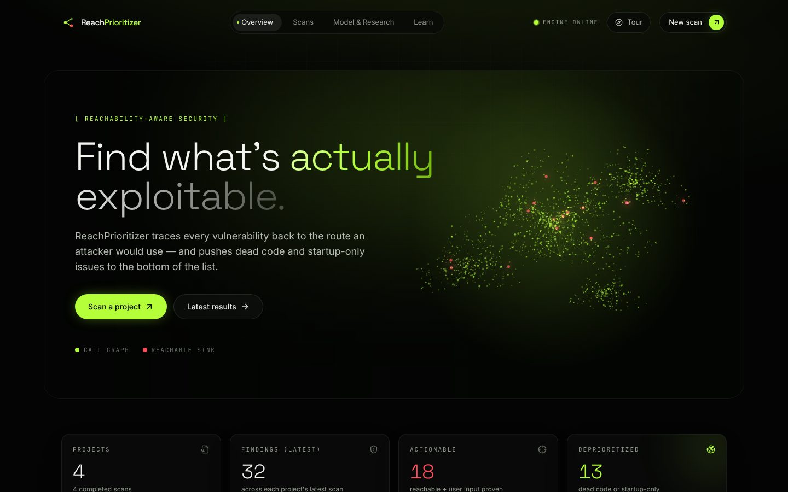
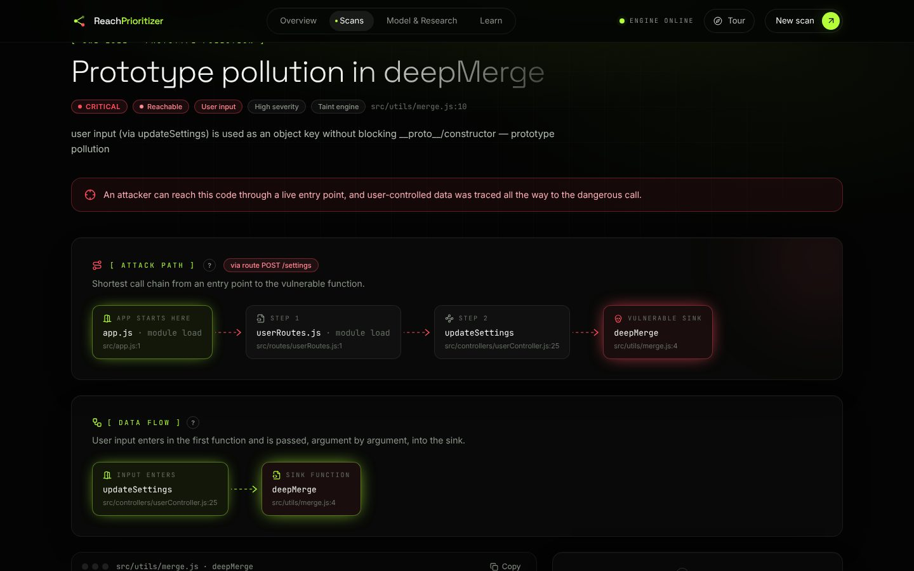
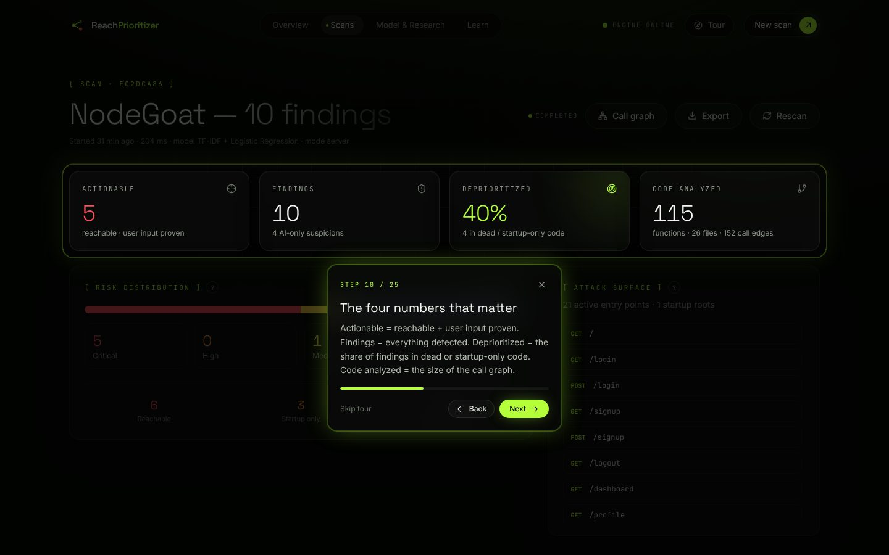
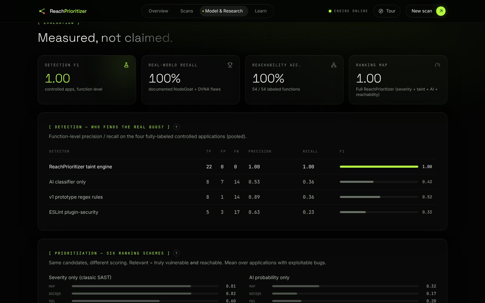

# ReachPrioritizer — The Simple Guide

*A plain-language explanation of the project for mentors, reviewers and new team members. No security or AI background needed.*

---

## 1. The project in one minute

Imagine a building with 500 doors. A security inspector gives you a list of 500 "weak locks". Some of those doors are bricked up behind a wall, and nobody can ever open them. Others face the street. **Which locks do you fix first?** Obviously the ones facing the street.

Software has the same problem. Security tools scan the code and report hundreds of "possible vulnerabilities". Many of them are in code that **never runs** or that **an attacker can never reach**. Developers waste time on those and sometimes miss the dangerous ones.

**ReachPrioritizer is a website where you upload a JavaScript / Node.js project and get back the list of vulnerabilities sorted by how dangerous they really are.** For every problem it also shows *how* an attacker would reach it (the "attack path").



---

## 2. What problem are we solving?

| Normal security scanners | ReachPrioritizer |
|---|---|
| "This function has an SQL injection." | "This function has an SQL injection, **an attacker can reach it through `POST /api/users/search`**, and the text the user types really ends up in the database query." |
| Every issue looks equally urgent. | Issues get a **risk score from 0 to 100** and are sorted. |
| Dead code still produces alarms. | Dead code is detected and pushed to the bottom. |
| No explanation of why something is dangerous. | Every score is explained, with the path and the code. |

**Research question:** *Does knowing which code is reachable (and whether user input really reaches the dangerous line) help put the real vulnerabilities at the top of the list?* Our measurements say **yes** (see section 8).

---

## 3. How it works — the 6 steps

Think of it as a detective working through the program:

1. **Read the code (parse).** Every `.js` / `.ts` file is turned into a tree structure (an *AST*) that the computer can walk through. The code is **never executed**, only read.
2. **Draw a map of who calls whom (call graph).** If function A calls function B, we draw an arrow A → B, across all files. Imports, classes and Express routers are understood.
3. **Find the doors (entry points).** Where can an attacker knock? Things like `app.get('/users/:id', ...)` — the routes of the web server. We also find the code that runs when the server starts.
4. **Walk the map from the doors (reachability).** Starting from the doors, we follow the arrows. Every function ends up as one of:
   - **Reachable**: an attacker's request can make it run.
   - **Startup only**: it only runs while the server boots.
   - **Dead code**: nothing ever calls it.
5. **Follow the user's data (taint tracking).** We track values that come from the user (`req.query`, `req.body`, …) through variables and function calls. If such a value reaches a **dangerous operation** (running a shell command, building an SQL query, `eval`, reading a file path, …) without being cleaned first, that's a vulnerability.
6. **Score and sort (prioritize).** Each finding gets a score:

   > **risk = 100 × reachability × (0.45 × severity + 0.35 × proof-of-user-input + 0.20 × AI opinion)**

   Reachability is a *multiplier*: ×1.0 if reachable, ×0.4 if startup only, ×0.2 if dead code. So a "critical" problem in dead code ends up with a low score, which is what we want.

There is also an **AI model** that reads every function and gives its own opinion ("80% likely vulnerable"). It's one input to the score (20%), not the main decision maker.

---

## 4. A concrete example

```js
// routes/files.js  — a web route
function executeCommand(req, res) {
  const cmd = req.query.cmd            // ① the user controls ?cmd=...
  res.json(executeCmd(cmd))            // ② passed to another function
}

// controllers/fileController.js
function runCommand(cmd) {
  execSync('ls ' + cmd)                // ③ runs a shell command with user text!
}
```

A user could call `/execute?cmd=; rm -rf /` and the server would run it. ReachPrioritizer reports:

- **What:** OS command injection (CWE-78), critical
- **Reachable:** yes, through the route `GET /execute`
- **Attack path:** `server.js → setupFileRoutes → executeCommand → executeCmd → runCommand`
- **Data flow:** user input enters in `executeCommand` and travels to `runCommand`
- **Score:** high, so it appears near the top of the list
- **Fix:** don't build shell commands from user text; use `execFile` with an allow-list.



---

## 5. A tour of the website

The website itself has a **guided tour** (the "Tour" button at the top) and a **Learn** page that explains every concept. Here's what each page does:

| Page | What you see / do |
|---|---|
| **Overview** | Dashboard: number of projects and scans, how many findings are *actionable* (reachable + proven user input), the risk mix and the most common vulnerability types. |
| **New scan** | Drag and drop a `.zip` of a project. The scan starts automatically and usually takes a few seconds. |
| **Scan results** | Summary numbers, risk distribution, the list of detected routes ("attack surface"), and the **ranked list of findings** with filters. Export as JSON, SARIF (for GitHub) or CSV. |
| **Finding detail** | One vulnerability in depth: attack path, data flow, highlighted code, why it got its score, how to fix it. |
| **Call graph** | An interactive map of the program. Red dots are vulnerable functions an attacker can reach. Click a dot to light up the path from a door to it. |
| **Scans** | History of all projects and scans; run again or delete. |
| **Model & Research** | Which AI model is active, how good it is, the training data, and our evaluation results. |
| **Learn** | Built-in guide: every concept, a risk-score calculator, vulnerability types, FAQ, glossary. |



---

## 6. Technologies used (and why)

| Part | Technology | What it is | Why we use it |
|---|---|---|---|
| Analysis engine | **Node.js** + **@babel/parser** | JavaScript runtime + the parser used by the Babel compiler | Babel understands every modern JavaScript and TypeScript syntax, and analyzing JS *with* JS is natural. |
| Backend (server) | **Python** + **FastAPI** | A modern, fast Python web framework | Easy REST APIs, automatic API docs at `/docs`, and Python is where the AI libraries live. |
| Database | **SQLite** | A database stored in a single file | No installation needed, perfect for a research prototype. |
| AI (default) | **scikit-learn** (TF-IDF + Logistic Regression) | Classic machine learning on text | Trains in a minute on a normal laptop CPU. |
| AI (optional) | **PyTorch** + **Hugging Face Transformers** (CodeBERT) | A neural network pre-trained on source code | Better understanding of code; trained on a GPU (e.g. RTX 4060). |
| Frontend (website) | **React** + **Vite** + **Tailwind CSS** | UI library + fast build tool + utility-first CSS | Modern, fast, and makes a polished design easy. |
| Graph view | **react-force-graph-2d** | Physics-based graph drawing | Interactive call-graph visualisation. |
| Reports | **SARIF 2.1.0** | Standard format for security results | Results can be shown directly in GitHub and VS Code. |

---

## 7. The data and the AI model, simply

- We used **JsVul**, a public dataset of **21,896 JavaScript functions** taken from real security fixes on GitHub (1,164 projects). About 9% of them are vulnerable, the rest are normal code.
- We split it into **train / validation / test** sets *by project*, so the model is tested on projects it has never seen. This prevents cheating.
- The default model (TF-IDF + Logistic Regression) finds **74% of the vulnerable functions** in the test set, but it also raises many false alarms (precision 28%). That's why the AI is only **one ingredient** of the score, and the concrete findings come from the rule-based taint engine.
- We also trained a neural network (**CodeBERT**) on an RTX 4060 laptop GPU (22 minutes). It did better on the validation data, but slightly **worse** on the final test set of unseen projects (F1 0.35 vs 0.40). The app always uses the model with the better test score, so it automatically kept TF-IDF. This is an honest research finding: a bigger model is not automatically better on new projects.

---

## 8. Results — does it work?

We tested on **6 applications**: 4 small labeled test apps (we know exactly which functions are vulnerable) and 2 well-known, intentionally vulnerable open-source apps (**OWASP NodeGoat** and **DVNA**).

**Finding the vulnerabilities (F1 score, 1.0 = perfect):**

| Tool | F1 score on labeled apps | Known bugs found in NodeGoat + DVNA |
|---|---|---|
| **ReachPrioritizer** | **1.00** | **11 / 11** |
| Our old prototype (v1) | 0.52 | 6 / 11 |
| ESLint security plugin (popular free tool) | 0.33 | 2 / 11 |
| AI model alone | 0.43 | 8 / 11 |

**Reachability:** correct for **54 / 54** labeled functions.

**Ranking:** we compared 6 ways of sorting the same findings. Sorting by severity only (what most tools do) puts a truly exploitable bug at #1 in 60% of the apps. **ReachPrioritizer puts one at #1 in 100% of them**, and gets a perfect score on the ranking metrics (MAP = 1.00).



**Honest limitations (good to mention to mentors):**
- The test apps are small, and some were written by us. The two real-world apps are the stronger evidence.
- For the real-world apps we only know the *documented* bugs, so we can measure what we found, but not every possible false alarm.
- Very "magic" JavaScript (code generated at runtime, dependency-injection frameworks) can hide calls from any static tool.
- We don't check third-party packages in `node_modules` (that's the job of tools like `npm audit`).

---

## 9. How the code is organised (folder by folder)

| Folder | In simple words |
|---|---|
| `analyzer/` | The "detective": reads the code, draws the call map, finds doors, follows user data, reports problems. Written in JavaScript. |
| `backend/` | The server: receives uploads, runs the detective and the AI, calculates scores, saves results, answers the website. Written in Python. |
| `ai/` | The AI model: the trained model files, the code that uses them, and the training scripts. |
| `frontend/` | The website you click around in. Written in React. |
| `test-applications/` | 4 small example apps with known answers, used for testing and demos (`.zip` versions ready to upload). |
| `evaluation/` | Scripts that measure how good the tool is, comparisons with other tools, and the results. |
| `preprocessing/` | Phase 1: scripts that cleaned and split the JsVul dataset. |
| `reports/` | Statistics about the dataset. |
| `docs/` | Documentation, including this guide and the research paper. |
| `scripts/` | Helper script to download and rebuild the dataset. |

A file-by-file explanation is in [`REPOSITORY_GUIDE.md`](REPOSITORY_GUIDE.md).

---

## 10. How to run a demo (5 minutes)

1. Install **Node.js 18+** (nodejs.org) and **Python 3.12** (python.org, tick "Add python.exe to PATH").
2. Double-click **`setup.bat`** in the project folder (only the first time; takes 2–5 minutes).
3. Double-click **`start.bat`**. Two server windows open and the website opens in your browser automatically.
4. Accept the guided tour, click **New scan** and upload `test-applications/express-app.zip`.
5. When you're finished, double-click **`stop.bat`**.

(On Linux/macOS, follow the manual steps in the README.)

**Suggested demo script for a presentation:**
1. Overview page: explain the problem (alert fatigue) using the "Actionable" vs "Deprioritized" numbers.
2. Upload `express-app.zip`. Show the live progress.
3. Scan results: the top items are reachable and have proven user input. Point at the dead-code item (`adminEval`) sitting at the bottom despite being "critical".
4. Open the #1 finding: walk through the attack path, data flow, code and score breakdown.
5. Call graph: click the red dot and watch the path light up.
6. Model & Research: show the comparison with the other tools.
7. Learn page: play with the risk calculator.

---

## 11. Glossary

| Term | Meaning |
|---|---|
| **Vulnerability** | A mistake in code that an attacker can abuse. |
| **CWE** | A standard number for a type of vulnerability (CWE-89 = SQL injection, CWE-78 = command injection…). |
| **Static analysis** | Checking code by reading it, without running it. |
| **AST** | The code turned into a tree the computer can walk. |
| **Call graph** | Map of which function calls which. |
| **Entry point** | Where execution starts: server start-up, or a web route. |
| **Reachable** | Can be executed when an attacker sends a request. |
| **Taint / source / sink** | Taint = "this value came from the user". Source = where user data enters. Sink = a dangerous operation. |
| **Sanitizer** | Something that makes user data safe (escaping, converting to a number…). |
| **False positive** | An alarm that is not a real problem. |
| **Precision / Recall / F1** | Precision: how many alarms are real. Recall: how many real problems were found. F1: both combined. |
| **TF-IDF / CodeBERT** | Two kinds of AI models for reading code (simple/fast vs. neural/strong). |
| **SARIF** | Standard file format for security findings (GitHub understands it). |
