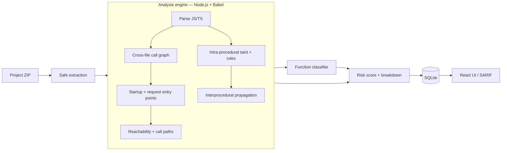

# ReachPrioritizer: Reachability- and Taint-Aware, AI-Assisted Vulnerability Prioritization for JavaScript / Node.js
## Technical Report and Research Paper Source Documentation — Version 2
**Authors / Research Team:** ReachPrioritizer Project
**Date:** 2026-11-22 (v2 — supersedes the v1 prototype report)
**Target Subject:** Software Security, Static Program Analysis, AI-Assisted Vulnerability Prioritization
**Repository & Scope:** JavaScript / TypeScript / Node.js

> **Note on v1 → v2.** The v1 prototype report claimed a reachability F1 of 1.0 while its own results file recorded 0.889. It also described a CodeBERT checkpoint (validation F1 = 0.0, produced by a `--quick-test` run) as the active model. Every number in this version is generated by `evaluation/scripts/run_experiments.py` and stored in `evaluation/results/comparative_evaluation.json`. Section 12 lists the corrections made to the v1 ground truth.

---

## Abstract
Static security tools and machine-learning vulnerability classifiers judge code in isolation. Developers therefore receive long lists of alerts, many of which sit in dead code, in modules that only run at start-up, or in functions that never receive attacker-controlled data. We present **ReachPrioritizer**, an end-to-end system for JavaScript / TypeScript / Node.js that ranks vulnerabilities by how exploitable they really are. It combines (i) a Babel-based analysis engine that builds a cross-file call graph, detects startup and request entry points (routes, request handlers), computes reachability with concrete call paths, and performs interprocedural taint tracking from user-input sources to dangerous sinks; (ii) a function-level vulnerability classifier trained on 17,621 repository-disjoint functions from the JsVul dataset; and (iii) an explainable risk score that multiplies severity, taint-based exploitability and AI probability by a reachability factor.

On four fully labeled applications (43 functions), the taint engine reaches precision, recall and F1 of 1.00. The v1 regex rules reach F1 0.52, ESLint plugin-security 0.33 and the AI classifier alone 0.43. On two real-world vulnerable applications (OWASP NodeGoat and DVNA) it recovers 11/11 documented code-level vulnerabilities, against 2/11 for ESLint plugin-security, and reachability is correct for all 54 labeled functions. Across six ranking schemes over the same candidates, the full model (severity + taint + AI + reachability) achieves the best mean MAP (1.00) and NDCG@5 (1.00). Severity-only ordering, the classic SAST default, reaches 0.81 / 0.82, and AI-only ordering 0.32 / 0.17. Reachability is what lifts the ranking: on the mixed benchmark, every scheme without reachability ranks a dead-code vulnerability first.

---

## 1. Project Overview

### 1.1 Project Title and Identity
- **Project Name:** ReachPrioritizer
- **Formal Title:** Reachability- and Taint-Aware, AI-Assisted Vulnerability Prioritization in JavaScript / Node.js Codebases
- **Core Technology Stack:** Node.js 18+ (@babel/parser analysis engine), Python 3.10+ (FastAPI, scikit-learn, optional PyTorch/Transformers), React 18 + Vite + Tailwind CSS, SQLite.

### 1.2 Research Questions
> **RQ1:** Does incorporating interprocedural call-graph reachability improve the precision of AI-based vulnerability prioritization in JavaScript/Node.js codebases?
>
> **RQ2:** Does taint evidence (proof that user input reaches the sink) improve detection and ranking beyond pattern-based rules and function-level ML classification?

### 1.3 Problem Statement & Motivation
Static Application Security Testing (SAST) and machine-learning vulnerability detectors share a critical limitation: they evaluate source code in isolation. A model trained to recognize SQL injection (CWE-89), command injection (CWE-78) or cross-site scripting (CWE-79) flags a vulnerable function body whether or not it can ever run in production, and whether or not attacker-controlled data can reach it. Abandoned prototypes, unreferenced modules, start-up configuration code and internal helpers that only see constants produce alerts that compete for attention with real, reachable flaws, and alert fatigue causes teams to ignore genuine threats.

### 1.4 Objectives
1. Build an AST-based **cross-file call-graph engine** for modern JavaScript (CommonJS and ES modules, classes, ES5 constructor functions, routers, callbacks, re-exports, TypeScript).
2. Detect **entry points** at two levels, startup roots and request roots, and classify every function as *reachable*, *startup-only* or *unreachable*, with a shortest call path.
3. Implement **interprocedural taint tracking** with sources, sanitizers, guard clauses and sinks, producing CWE-labeled findings.
4. Train and select a **function-level ML classifier** from measured test metrics only.
5. Define an **explainable risk score** and validate it against baselines on labeled controlled and real-world applications.
6. Provide a **web application** (FastAPI + React) for upload, triage, attack-path inspection, call-graph exploration and SARIF export.

---

## 2. Background and Related Concepts

### 2.1 Software Vulnerabilities and Common Weakness Enumeration (CWE)
Vulnerabilities in JavaScript web applications frequently arise from untrusted input propagation. The primary weaknesses addressed in this study include:
- **CWE-89 (SQL Injection):** Dynamic string concatenation into SQL queries without parameterized placeholders.
- **CWE-78 (OS Command Injection):** Direct interpolation of user input into system shell commands (e.g., `child_process.exec()`).
- **CWE-22 (Path Traversal):** Unsanitized file paths passed to filesystem APIs (`fs.readFile()`, `fs.readFileSync()`).
- **CWE-79 (Cross-Site Scripting):** Unescaped reflection of user input into DOM properties or HTML responses (`innerHTML`, `document.write`).
- **CWE-94 (Code Injection):** Execution of arbitrary code via `eval()`, `Function()`, or `vm.runInContext()`.
- **CWE-1321 (Prototype Pollution):** Unchecked recursive object assignments modifying `__proto__` or `constructor.prototype`.

### 2.2 Static Application Security Testing (SAST)
Traditional SAST engines (e.g., Semgrep, ESLint Security plugins, CodeQL) match AST patterns or compute intraprocedural taint flows. While effective at identifying local vulnerability signatures, standard rule-based scanners rarely establish full end-to-end call-chain reachability from HTTP route handlers to sink functions across multi-file modular codebases.

### 2.3 AI-Based Code Representation & Microsoft CodeBERT
Pre-trained Transformer models for source code, notably Microsoft's **CodeBERT** (Feng et al., 2020), extend the RoBERTa architecture by pre-training on bimodal data (natural language documentation paired with source code across six programming languages). CodeBERT represents code tokens through 12 Transformer layers with 768 hidden dimensions and 12 attention heads (approx. 125 million parameters). For sequence classification, a binary classification head is affixed to the `[CLS]` token embedding to output the probability of vulnerability:

$$\hat{y} = \sigma\left(W_2 \cdot \tanh(W_1 \cdot h_{\text{CLS}} + b_1) + b_2\right)$$

### 2.4 Interprocedural Call-Graph Analysis
An interprocedural call graph is a directed graph $G = (V, E)$, where $V$ represents the set of all declared functions in the project (including module top-level scripts), and an edge $(u, v) \in E$ denotes that function $u$ contains a call site that invokes function $v$. In JavaScript, static call-graph construction presents unique challenges due to dynamic typing, higher-order functions, callbacks, and varying module systems (CommonJS vs. ES Modules).

### 2.5 Program Reachability
Given a designated set of application entry points $S \subseteq V$ (e.g., HTTP listener entry points, CLI command scripts, exported API interfaces), a target function $t \in V$ is **statically reachable** if there exists a directed path from some $s \in S$ to $t$:

$$\text{Reachable}(t) \iff \exists s \in S \text{ such that } s \rightsquigarrow t$$

If no path exists, $t$ is classified as **Unreachable from Analyzed Entry Points**. If the function or its callers cannot be statically resolved, its status is **Unknown**.

---

## 3. Dataset Description and Methodology

The experimental training pipeline utilizes the curated **JsVul** dataset (Phase 1 assets preserved in `data/processed/`).

### 3.1 Dataset Inventory & Statistics (Verified Actual)
The dataset represents real-world JavaScript functions extracted from GitHub security fix commits across 1,164 distinct repositories.

| Metric | Measured Value | Validation Note |
|---|---:|---|
| Raw JSON Files Scanned | 3,840 | Verified during Phase 1 |
| Valid JSON Files | 3,840 | 0 corrupt files |
| Total Function Records Extracted | 21,901 | Before cleaning |
| Filtered (< 10 chars source) | 5 | Trivially empty snippets removed |
| **Usable Samples** | **21,896** | Cleaned dataset baseline |
| Vulnerable Functions ($y=1$) | 2,039 | 9.312% of corpus |
| Benign Functions ($y=0$) | 19,857 | 90.688% of corpus |
| Class Imbalance Ratio | ~ 9.74 : 1 | Benign to Vulnerable |
| Contributing Organizations | 973 | Diverse GitHub owners |
| Contributing Repositories | 1,164 | Independent codebases |
| Fix Commit Pairs | 1,960 | Vulnerable vs. fixed pairs |
| Unique CWEs Represented | 183 | Top: CWE-79 (6,794), CWE-1321 (1,983), CWE-22 (1,365) |
| Unique CVEs Covered | 1,769 | Real-world advisory links |
| Exact Duplicate Records | 0 | Verified by SHA-256 hash |
| Normalized Duplicate Records | 0 | Verified by whitespace-normalized hash |
| JavaScript Parser Success Rate | 99.38% | 21,761 succeeded |
| Parse Failures (Retained) | 135 (0.62%) | Retained and flagged (TypeScript/Flow syntax) |

### 3.2 Near-Duplicate Analysis Limitation
Near-duplicate analysis was conducted during Phase 1 using MinHash and Locality-Sensitive Hashing (LSH) with a Jaccard similarity threshold of $\theta \ge 0.80$. Due to $O(N^2)$ memory constraints, this analysis was performed on a random sample of 1,500 records rather than the full 21,896 dataset. Within the sample, 422,304 near-duplicate pairs were identified, reflecting the fact that vulnerable and fixed functions within the same commit pair differ by only a few lines.

### 3.3 Repository-Disjoint Splitting & Leakage Prevention
To prevent data leakage, dataset splitting was performed at the **repository boundary** using a deterministic PRNG (seed = 42). All functions originating from a single GitHub repository are confined strictly to one partition.

| Partition | Total Records | Repositories | Vulnerable | Benign | Vuln % |
|---|---:|---:|---:|---:|---:|
| **Training Split** | 17,621 | 917 | 1,567 | 16,054 | 8.89% |
| **Validation Split** | 2,194 | 108 | 229 | 1,965 | 10.44% |
| **Testing Split** | 2,081 | 139 | 243 | 1,838 | 11.68% |
| **Total** | **21,896** | **1,164** | **2,039** | **19,857** | **9.31%** |

Disjointness verification confirmed:
$$\text{Train}_{\text{repos}} \cap \text{Val}_{\text{repos}} = \emptyset, \quad \text{Train}_{\text{repos}} \cap \text{Test}_{\text{repos}} = \emptyset, \quad \text{Val}_{\text{repos}} \cap \text{Test}_{\text{repos}} = \emptyset$$

### 3.4 Benchmarks Used for Evaluation
SecBench.js was not available, and no SecBench.js results are reported. The system is evaluated on:

1. **Four controlled applications** (`test-applications/`), fully labeled at function level (vulnerable / safe, reachable / not reachable):
   - *vulnerable-app* (8 vulnerable, 1 safe labeled), *secure-app* (8 safe — same features, secure implementations), *mixed-app* (5 vulnerable, 5 safe, reachable and dead modules), and *express-app* (9 vulnerable, 7 safe). express-app was added in v2 and uses realistic Express patterns: routers mounted with `app.use`, a class-based service instantiated in a controller, `exports.x =` controllers, a dead router file, an unreferenced controller, sanitizers (`path.basename`, HTML escaping), parameterized queries, `execFile` without a shell, and a start-up timer job.
2. **Two real-world intentionally vulnerable applications**, pinned to exact commits (`evaluation/realworld/fetch_realworld.sh`): **OWASP NodeGoat** (`c5cb68a`, 26 analyzed files, 115 functions) and **DVNA** (`9ba473a`, 12 files, 74 functions). The ground truth lists their documented code-level vulnerabilities (5 and 6), taken from the projects' tutorials and verified by reading the code. Template-level XSS, access control and configuration issues are out of scope.

---

## 4. System Architecture



### 4.1 Data Flow
1. **Upload and safe extraction.** ZIP entries are checked for path traversal, absolute paths, symlinks, file count, total uncompressed size and compression ratio (zip-bomb defence). Only source and JSON files are extracted, and `node_modules` is skipped.
2. **Analysis engine** (`analyzer/analyze.js`, one pass, one parser). It emits functions (with source), call edges, entry points, per-function reachability with paths, and taint-aware findings as a single JSON document. Test, tooling and documentation code (`test/`, `cypress/`, `*.spec.js`, `Gruntfile.js`, `*.config.js`, …) is excluded by default.
3. **AI scoring.** Every function body is scored by the selected classifier.
4. **Risk scoring and persistence.** Findings, the call graph (keyed per scan), entry points and a scan summary are written in one transaction.
5. **Presentation.** REST API, React UI, and JSON/SARIF/CSV exports.

Using a single parser removes a v1 defect. v1 extracted functions with tree-sitter (Python) and built the call graph with Babel (Node.js) under different naming schemes. Joining the two by name and file fell back to file-level matches, so reachability could be attributed to the wrong function.

---

## 5. AI Vulnerability Classification Model

### 5.1 Models and Selection Policy
- **TF-IDF + Logistic Regression** (word 1–2-grams, 10,000 features, balanced class weights), trained on the training split.
- **CodeBERT** (`microsoft/codebert-base`) fine-tuned with `ai/training/train_codebert.py`: bf16/fp16 mixed precision, dynamic padding, class-weighted loss, early stopping on validation F1, a decision threshold tuned on validation and applied once to test.

The backend selects the model with the highest *recorded test F1* (`RP_MODEL=auto`). Checkpoints from `--quick-test` runs, or checkpoints without recorded test metrics, are never auto-selected. This prevents the v1 failure mode, where a CodeBERT checkpoint with validation F1 = 0.0 silently replaced the working model.

### 5.2 Measured Performance (held-out test split, 2,081 functions, 243 vulnerable)

| Model | Precision | Recall | F1 | ROC-AUC | Status |
|---|---:|---:|---:|---:|---|
| TF-IDF + LR (threshold 0.5) | 0.276 | 0.737 | 0.402 | 0.806 | active (re-verified through the v2 inference path) |
| CodeBERT (v1 quick-test checkpoint) | 0.000 | 0.000 | 0.000 | – | not eligible |
| CodeBERT (full GPU training) | – | – | – | – | to be trained with the v2 script; selected automatically if better |

The classifier's precision is low, which is typical of function-level vulnerability classification under 9:1 imbalance. This is why it is used as one weighted signal (20%) and to raise *AI-suspected* functions (probability ≥ 0.85), but never as the sole detector.

---

## 6. Static Analysis Engine

### 6.1 Functions and Naming
Every `FunctionDeclaration`, function/arrow expression, object method, class method and class-field function becomes a node, plus one `__top_level__` node per module. Names reflect context: `UserService.search`, `ContributionsHandler.handleContributionsUpdate` (ES5 constructor), `<GET /greet handler>` (inline route handler), `<exec callback>`.

### 6.2 Call Resolution
Edges are created for: direct calls to local functions; named, default and namespace imports (CommonJS destructuring and ESM, including re-exports and `export *`); `module.exports = {…}` / `exports.x =` / `module.exports = fn | new C() | C`; `this.m()` within classes, object literals and ES5 constructors; `x.m()` where `x = new C()` (including imported classes and superclasses); `require('./x')(args)`; IIFEs; and **callbacks**, meaning functions passed as arguments (inline or by reference). Module imports add an edge to the imported module's top level, because loading a module executes it.

### 6.3 Entry Points
- **Startup roots:** modules calling `listen()`, `http(s).createServer`, `package.json` `main` / `bin` / `scripts.start`, `require.main === module`, or user overrides.
- **Request roots:** handlers registered with `get/post/put/delete/patch/all/use(path, …handlers)` (Express, Koa routers, Fastify shorthand), `route({handler})` (Fastify / hapi), `createServer(handler)`, `server.on('request')`, serverless `handler` exports and Next.js API routes. A route is **active** only if the function that registers it is reachable from a startup root. Routes in dead router files are therefore listed but inactive.

### 6.4 Reachability
A multi-source BFS from startup roots and from active request roots assigns every function one of: **reachable** (reachable from an active request root), **startup_only** (executed only during start-up, so not attacker-driven), or **unreachable**. If no request roots exist (libraries), exported functions of root modules form the attack surface. Each reachable function stores the shortest path `startup root → … → registering function → handler → … → function`.

### 6.5 Taint Analysis
Within each function, a flow-insensitive fixpoint propagates labels through declarations, destructuring, assignments, `for…in/of`, template literals, concatenation, logical and conditional expressions, object/array literals and call results. Labels are `U` (user input) or `P(f,i)` (parameter *i* of function *f*; nested functions inherit closure variables). Sources include `req/request.{body,query,params,headers,cookies,url,…}`, `ctx.request.*`, Lambda `event.*`, `req.get()`/`req.param()`, `process.argv` and DOM location/cookie. Sanitizers (`escape*`, `sanitize*`, `encode*`, `parseInt`, `Number`, `path.basename`, `JSON.stringify` for XSS) and **guard clauses** (an `if` whose branch returns, throws or continues and whose test validates the variable with `includes/has/test/startsWith`, `is*/valid*` functions or literal comparisons) clear the taint.

**Interprocedural propagation.** Each finding labelled `P(f,i)` is a summary "parameter *i* of *f* reaches a sink". Call sites record per-argument labels. A BFS starting from call sites that pass `U` follows parameter-to-parameter flows across functions and files, and confirms every summary it reaches. Confirmed findings store the **taint path** (the function where input enters → … → sink function).

### 6.6 Rules (sinks)
Command injection (CWE-78: `child_process.exec/execSync`, `spawn/execFile` with an attacker-chosen binary or `shell: true`, `shelljs`); code injection (CWE-94: `eval`, `Function`, `vm.*`, string timers, `mathjs.eval`); SQL injection (CWE-89: query/execute/raw sinks, and SQL statements built by concatenation; tagged templates and placeholder queries are safe); NoSQL injection (CWE-943: `$where`, request objects as queries); path traversal (CWE-22: `fs.*`, `res.sendFile/download`); SSRF (CWE-918: http/https/axios/got/request/needle/superagent/undici/fetch, including config-object URLs); open redirect (CWE-601); XSS (CWE-79: reflected responses, HTML built from input, `innerHTML`, `document.write`, `dangerouslySetInnerHTML`); prototype pollution (CWE-1321: attacker-controlled computed keys, `__proto__` writes); XXE (CWE-611: libxmljs with `noent`); insecure deserialization (CWE-502); ReDoS (CWE-1333: nested-quantifier regexes on input, dynamic `RegExp`); hardcoded credentials (CWE-798); weak hashing (CWE-327); disabled TLS verification (CWE-295). Findings are merged per (function, CWE), keeping the strongest evidence and all related lines.

---

## 7. Contextual Risk Prioritization Formula

$$\text{Risk} = 100 \times M_{\text{reach}} \times \left(0.45\,S_{\text{sev}} + 0.35\,E_{\text{taint}} + 0.20\,P_{\text{AI}}\right)$$

| Component | Values |
|---|---|
| $S_{\text{sev}}$ severity | critical 1.0, high 0.8, medium 0.55, low 0.3, info 0.1 |
| $E_{\text{taint}}$ exploitability | user input proven 1.0, parameter only 0.6, no data flow 0.35, AI-only 0.3 |
| $P_{\text{AI}}$ | classifier probability of the enclosing function |
| $M_{\text{reach}}$ | reachable 1.0, unknown 0.6, startup-only 0.4, unreachable 0.2 |

Categories: Critical ≥ 70, High ≥ 45, Medium ≥ 25, Low < 25. The API returns each component's contribution, and the UI shows them on every finding.

---

## 8. Implementation

| Layer | Technology |
|---|---|
| Analysis engine | Node.js 18+, @babel/parser (JS, JSX, TS), ~2,200 lines, 11 tests |
| Backend | FastAPI, SQLite (WAL, schema v2 with per-scan graph keys and cascading deletes), background worker threads with a concurrency limit, 19 tests |
| AI | scikit-learn (TF-IDF), PyTorch + Transformers (CodeBERT, optional) |
| Frontend | React 18, Vite 6, Tailwind CSS, react-force-graph-2d, self-hosted variable fonts |
| Reports | JSON, SARIF 2.1.0, CSV |

Analysis of each benchmark takes 0.07–0.12 s, including AI scoring.

---

## 9. Experimental Evaluation

### 9.1 Setup
All experiments run the production code path (`build_findings` from the backend). Detection is measured at function level on labeled functions. For ranking, each function appears once, with its highest-risk finding. AI-flagged functions (probability ≥ threshold) are added as candidates so that the AI-only scheme is evaluated fairly. A candidate is **relevant** when the ground truth marks it vulnerable **and** reachable. Ties are broken alphabetically by function id.

### 9.2 Detection (controlled applications, pooled; 22 vulnerable / 21 safe labeled functions)

| Detector | TP | FP | FN | Precision | Recall | F1 |
|---|---:|---:|---:|---:|---:|---:|
| **ReachPrioritizer taint engine** | 22 | 0 | 0 | **1.000** | **1.000** | **1.000** |
| v1 prototype regex rules | 8 | 1 | 14 | 0.889 | 0.364 | 0.516 |
| AI classifier only (TF-IDF) | 8 | 7 | 14 | 0.533 | 0.364 | 0.432 |
| ESLint + eslint-plugin-security | 5 | 3 | 17 | 0.625 | 0.227 | 0.333 |

On secure-app, the engine reports nothing. The AI classifier flags 5 of the 8 secure functions, ESLint 2 and the regex rules 1.

**Real-world recall** (documented vulnerabilities): ReachPrioritizer 11/11 (NodeGoat 5/5, DVNA 6/6); AI classifier 8/11; v1 regex rules 6/11; ESLint plugin-security 2/11.

### 9.3 Reachability
Across all six applications, 54/54 labeled functions are classified correctly (TP 38, TN 16, FP 0, FN 0).

### 9.4 Prioritization (mean over the five applications with exploitable vulnerabilities)

| Scheme | P@1 | P@3 | P@5 | NDCG@5 | NDCG@10 | MAP |
|---|---:|---:|---:|---:|---:|---:|
| E0 Severity only (classic SAST) | 0.600 | 0.733 | 0.760 | 0.816 | 0.865 | 0.813 |
| E1 AI probability only | 0.200 | 0.200 | 0.160 | 0.171 | 0.388 | 0.322 |
| E2 AI + severity | 0.800 | 0.667 | 0.640 | 0.757 | 0.849 | 0.753 |
| E3 AI + reachability | 0.200 | 0.333 | 0.400 | 0.442 | 0.587 | 0.498 |
| E4 AI + severity + reachability (v1 formula) | 1.000 | 0.867 | 0.760 | 0.948 | 0.991 | 0.972 |
| **E5 Full ReachPrioritizer** | **1.000** | **0.867** | **0.840** | **1.000** | **1.000** | **1.000** |

P@3 and P@5 cannot reach 1.0 when an application has fewer than 3 or 5 exploitable functions (mixed-app has one).

### 9.5 Case study: mixed-app
Without reachability (E0, E2), the first-ranked item is `exportLegacyBackup`, a command injection in a module that is never imported. The AI-only ranking (E1) puts three non-vulnerable functions first. With reachability (E4, E5), the single exploitable function `processCommand` (GET /api/process → handleProcess → processCommand → `exec`) is ranked first. `fetchExternalReport` contains an SSRF, but its only caller `handleFetch` is never registered as a route. The engine marks it unreachable and ranks it low even though the taint flow is real.

---

## 10. REST API
`POST /api/projects/upload` (optionally starts a scan) · `GET/DELETE /api/projects[/{id}]` · `POST /api/scans` · `GET/DELETE /api/scans[/{id}]` (status, stage, progress, summary) · `GET /api/scans/{id}/findings` (filters: severity, reachability, category, taint, type, search, sort) · `GET /api/scans/{id}/findings/{fid}` (resolved call path and taint path) · `GET /api/scans/{id}/graph` (`focus=all|reachable|findings`) · `GET /api/scans/{id}/entry-points` · `GET /api/scans/{id}/export?format=json|sarif|csv` · `GET /api/model/status` · `GET /api/evaluation` · `GET /api/stats`.

---

## 11. Results and Discussion
1. **Rules without data flow miss most real flaws.** Pattern rules (v1 regex, ESLint) look for a dangerous call with a suspicious-looking argument in the same expression. Real code moves input through variables and across functions (route → controller → service), which is why their recall is 0.23–0.36. Taint summaries recover these flows.
2. **Function-level ML is a weak detector but a useful signal.** With test precision 0.28, the classifier alone produces false alarms (5 on secure-app) and ranks poorly (MAP 0.32). Weighted at 20%, it does not hurt the full model.
3. **Reachability decides the order.** Every scheme that includes reachability ranks an exploitable function first in all five applications. Schemes without it promote dead or startup-only code in mixed-app and vulnerable-app.
4. **Taint evidence separates "reachable" from "exploitable".** It moves startup-only issues fed only with constants (vulnerable-app `mergeConfig`) and configuration issues (hardcoded secrets) below proven flows. This lifts NDCG@5 from 0.948 (E4) to 1.000 (E5).

---

## 12. Threats to Validity and Limitations

### 12.1 Ground-truth corrections (v1 → v2)
Running the new engine against the v1 labels showed three labeling errors, which were corrected and documented in each `ground-truth.json` under `corrections_from_v1`:
- mixed-app `fetchExternalReport` was labeled reachable, but its only caller `handleFetch` is never registered as a route.
- mixed-app `sanitizeString` was labeled reachable, but it is imported and never called.
- vulnerable-app `renderPage` was missing although the source marks it vulnerable (CWE-79). It is added as vulnerable and unreachable.

Reachability is defined as *reachable from an active request entry point*. Code that runs only at start-up counts as not reachable, which is consistent with the original label for `mergeConfig`.

### 12.2 Internal validity
The controlled applications were written by the project team, and express-app was written during v2 development, so they may favour patterns the engine supports. The real-world benchmark was not used for development beyond adding generic constructs (ES5 constructor methods, `require('./x')()`, `$where`, XXE, `mathjs.eval`, ReDoS) that are documented vulnerability classes.

### 12.3 External validity
The benchmarks are small (6 applications, 54 labeled functions). The real-world ground truth contains only documented vulnerabilities, so precision on real projects is not measured. Each project produced a few extra findings: one hardcoded password in a NodeGoat seed script, two weak-hash (md5) uses and AI-only suspicions. Large-scale evaluation (e.g. SecBench.js, CVE-linked npm packages) is future work.

### 12.4 Analysis limitations
JavaScript's dynamism limits static resolution: computed property calls, dependency-injection containers and generated code can hide edges, and object-field aliasing is approximated. Taint tracking is flow-insensitive inside a function. Server-side template XSS, authentication and authorization flaws, and vulnerable dependencies are out of scope.

---

## 13. Future Work
1. Fully train CodeBERT / UniXcoder on GPU and report its test metrics. It is selected automatically if better.
2. Evaluate on SecBench.js and a corpus of CVE-linked npm packages with reproduced exploits.
3. Field-sensitive and flow-sensitive taint, and summaries for popular npm libraries (ORMs, template engines).
4. Dependency-aware reachability: whether vulnerable functions of third-party packages are reachable from application code.
5. CI integration (GitHub Action posting SARIF with risk-ranked alerts).

---

## 14. Conclusion
ReachPrioritizer shows that function-level vulnerability detection becomes actionable once it is grounded in program context. Interprocedural taint tracking finds flaws that pattern rules miss (F1 1.00 vs 0.33–0.52 on labeled applications; 11/11 documented real-world vulnerabilities). Request-level reachability, refined with taint evidence, puts the exploitable vulnerability first in every evaluated application (mean MAP 1.00 vs 0.81 for severity-only ordering). All numbers are generated by scripts in the repository and can be reproduced.

---

## 15. References
1. Feng, Z., Guo, D., Tang, D., Duan, N., Feng, X., Gong, M., Shou, L., Qin, B., Liu, T., Jiang, D., & Zhou, M. (2020). *CodeBERT: A Pre-Trained Model for Programming and Natural Languages*. Findings of EMNLP 2020. arXiv:2002.08155.
2. Guo, D., Lu, S., Duan, N., Wang, Y., Zhou, M., & Yin, J. (2022). *UniXcoder: Unified Cross-Modal Pre-training for Code Representation*. ACL 2022.
3. MITRE. *Common Weakness Enumeration (CWE)*. https://cwe.mitre.org
4. OASIS. *Static Analysis Results Interchange Format (SARIF) Version 2.1.0*.
5. OWASP NodeGoat. https://github.com/OWASP/NodeGoat
6. Appsecco. *Damn Vulnerable NodeJS Application (DVNA)*. https://github.com/appsecco/dvna
7. JsVul dataset. https://github.com/jsvul/jsvul
8. eslint-plugin-security. https://github.com/eslint-community/eslint-plugin-security

---

## 16. Reproducibility Guide
```bash
npm install                                   # analysis engine deps
pip install -r backend/requirements.txt       # backend + TF-IDF
bash scripts/fetch_dataset.sh                 # JsVul @036c7f7 -> data/processed (seed 42)
python ai/training/train_fallback.py          # TF-IDF (CPU, ~1 min)
python ai/training/train_codebert.py          # optional, GPU (see docs/AI_MODEL_AND_TRAINING.md)
bash evaluation/realworld/fetch_realworld.sh  # NodeGoat + DVNA (pinned)
(cd evaluation/baselines/eslint && npm install)
npm run test:analyzer && (cd backend && python -m pytest)
python evaluation/scripts/run_experiments.py  # -> evaluation/results/{comparative_evaluation.json,RESULTS.md}
```
